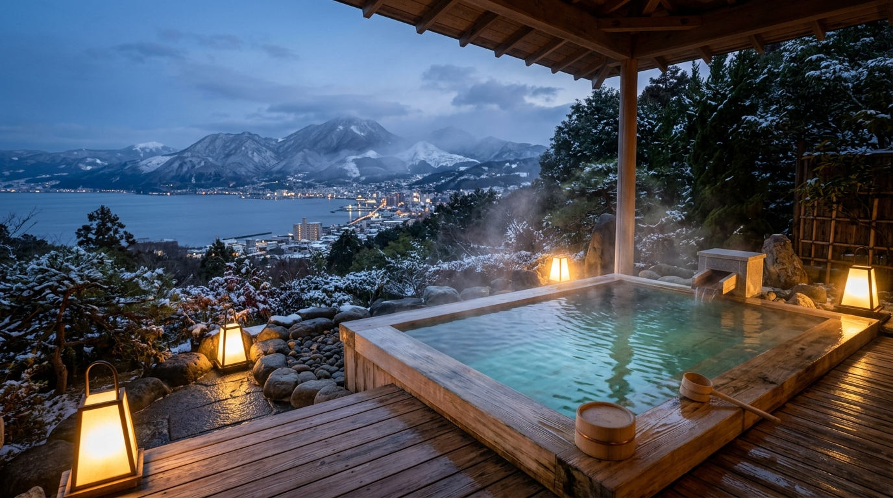

# ♨️ Kyushu Onsen Family Travel Journal (규슈 겨울 온천 여정 노트)

> **성인 3인 + 13개월 유아를 위한 3박 4일 규슈 온천 여행 가이드 & WebGPU 셰이더 인터랙티브 웹**  
> (2026. 12. 21 월 ~ 12. 24 목)



---

## 🌟 프로젝트 소개 (Overview)

13개월 영아와 성인 3인이 함께하는 일본 규슈(벳푸·유후인 / 우레시노·다케오 / 유후인·후쿠오카) 3박 4일 겨울 온천 여정을 설계한 감성 에디토리얼 저널 웹 애플리케이션입니다.
스테이폴리오(Stayfolio) 및 호시노야 스타일의 정갈한 미학과 WebGPU 셰이더(`shaders` 라이브러리)를 접목하여 물결치는 온천 증기와 노천탕의 분위기를 시각화했습니다.

### ✨ 주요 기능
- **WebGPU 셰이더 배경 (`shaders/react`)**: 히노키 탕 물결(WGSL 커스텀 셰이더), 벳푸 증기, 유후인 안개, 우레시노 실크 온천 분위기 전환
- **3대 추천 지역 비교 (Chapter 01)**: 벳푸·유후인 / 우레시노·다케오 / 유후인·후쿠오카 온천 수질(아기 피부 저자극도), 공항 이동시간, 객실 구조 비교
- **시간대별 타임라인 (Chapter 02)**: 13개월 아기 낮잠 및 이유식 리듬과 성인 3인의 교대 휴식을 고려한 맞춤형 동선
- **항공 · 렌터카 · 료칸 큐레이션 (Chapter 03)**:
  - 성인 3인 + 13개월 유아 맞춤 항공편(대한항공/아시아나/제주항공 오이타직항/티웨이 사가직항/진에어)
  - 8인승 패밀리 미니밴(알파드/세레나) 카시트 & 28인치 캐리어 3개 적재 규격
  - 료칸별 **아고다·트립닷컴 특가(조식포함) / 아고다·라쿠텐 특가(조·석식 2식) / 공식 정가** 3단계 실결제가 비교 및 실시간 검색 링크
  - 13개월 아기 **소이네(添い寝, 동반취침)** 예약 팁으로 15~20만 원 절약하는 가이드 제공
- **맞춤 견적서 & 영아 안전 체크리스트 (Chapter 04)**: 항공, 숙박, 교통, 예비비를 합산한 총액 및 1인당 부담액 자동 계산, 축산물 검역 및 온천 입욕 수칙 체크리스트

---

## 🛠️ 기술 스택 (Tech Stack)

- **Framework**: React 19, TypeScript, Vite 6
- **Styling**: Tailwind CSS v4, Lucide Icons
- **Visuals / Shaders**: WebGPU `shaders` (`shaders/react`, `shaders/std`), Custom WGSL Shaders
- **Typography**: Cormorant Garamond, Noto Serif KR, Pretendard

---

## 🚀 로컬 실행 방법 (Local Development)

```bash
# 1. 의존성 설치
npm install

# 2. 개발 서버 시작
npm run dev
# 브라우저에서 http://localhost:5173 접속

# 3. 프로덕션 빌드 및 미리보기
npm run build
npm run preview
```

---

## ☁️ Vercel 배포 가이드 (Deployment on Vercel)

1. [GitHub Repository](https://github.com/Th3Sign/kyushu-onsen-travel)에 소스 코드를 push합니다.
2. [Vercel 대시보드](https://vercel.com/new)에 접속합니다.
3. GitHub 계정을 연동한 후 `kyushu-onsen-travel` 리포지토리를 **Import**합니다.
4. Framework Preset이 **Vite**로 자동 감지되며, Build Command(`npm run build`), Output Directory(`dist`) 기본값 그대로 **Deploy**를 누르면 배포가 완료됩니다!
